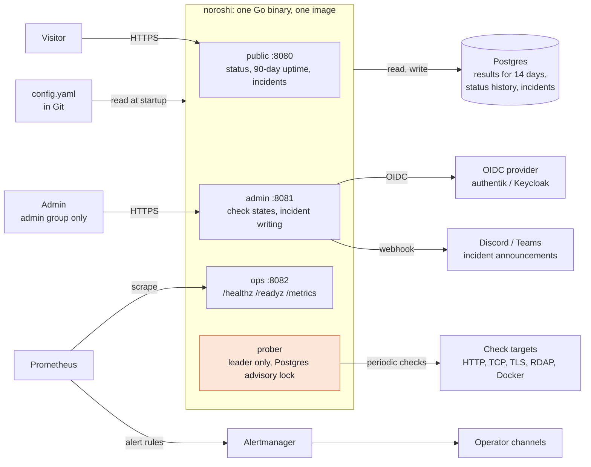
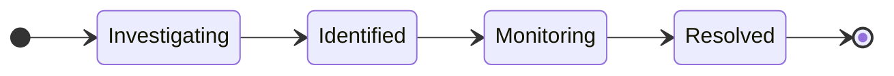

# noroshi architecture

noroshi puts health checks, a public status page, and incidents into one Go binary. It runs on a homelab (compose) first, and the same image runs on Kubernetes through the Helm chart. It builds no operator alerting of its own; the existing Prometheus and Alertmanager handle that.

## Components

On Kubernetes there can be several replicas. All of them serve pages; only the one holding the advisory lock runs checks, and another takes over within about 10 seconds if it stops.

## How data flows

1. At startup noroshi reads `config.yaml` and brings pages, components, and checks in the database in line with it. `key` is the anchor; removed items are archived.
2. The prober on the leader runs the checks and stores the results in Postgres.
3. When a check changes state under the judgement rules, the component gets a new entry in its status history. Uptime is counted per day from that history.
4. An open incident can set a component's status. While it is open, that status replaces what the checks say and counts toward uptime.
5. The public listener reads all of this to draw the page. The admin listener writes incidents and can announce each update to Discord or Teams.
6. Prometheus scrapes `/metrics` on the ops listener, and Alertmanager sends operator alerts through the existing channels.

## Incident stages

An update may pick any stage; the arrows show the usual order. Only Resolved closes the incident, releases the component statuses it set, and moves it to the past incidents list. Entries added after that are notes.

## What changes between environments

| Target | Homelab | Kubernetes (example stack) |
| -- | -- | -- |
| Runtime | One compose service | Deployment, several public replicas are fine |
| Public route | Reverse proxy → :8080 | Service and route → :8080 (internal network) |
| Admin route | Reverse proxy → :8081 | Internal route → :8081 |
| Sign-in | authentik | Keycloak |
| Database | Existing Postgres | CloudNativePG |
| Secrets | Host files → `*_FILE` | ESO Secret → `*_FILE` |
| Scraping | Scrape config → :8082 | ServiceMonitor → :8082 |

## Phases

| Phase | Scope | State |
| -- | -- | -- |
| 1. Replace Kuma | Checks, judgement, component status, public page, uptime, `/metrics`, admin sign-in | Done |
| 2. Incidents | Timeline (Investigating → Identified → Monitoring → Resolved), past records, manual status, Teams and Discord announcements | Done |
| 3. Extensions | Scheduled maintenance, subscriptions (RSS, then mail), incident drafts from Alertmanager webhooks, static export, `push` checks | Not started |
| 4. Kubernetes | Helm chart with ServiceMonitor, PrometheusRule, routes, and probes; several replicas | Chart done and run on k3s; production trial pending |

The rules behind each step are in [PLAN.md](PLAN.md).
